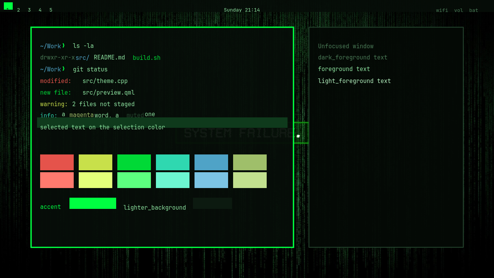

# Digital Rain (Matrix)

A dark Omarchy theme inspired by *The Matrix*: phosphor-green glyphs falling through a CRT-black void.



## Install

```bash
omarchy theme install https://github.com/Farrooss/omarchy-digital-rain-matrix-theme
```

Or open the Omarchy menu (`Super + Alt + Space`) and choose **Install > Style > Theme**, then paste the repo URL.

## Palette

| Role | Color |
|---|---|
| Background | `#060d08` |
| Foreground | `#8fe6a2` |
| Accent | `#00ff41` |
| Selection | `#0f3a1c` |

Red, yellow, cyan and blue stay distinct so errors and warnings still read at a glance; every app's colors are generated from `colors.toml`.

## Wallpapers

All four are from [Wallhaven](https://wallhaven.cc). Rights belong to their original creators:

1. `1-system-failure.jpg` — <https://wallhaven.cc/w/nrl2yw> (uploaded by neo937)
2. `2-falling-code.jpg` — <https://wallhaven.cc/w/nrzpwj>
3. `3-glyph-rain.jpg` — <https://wallhaven.cc/w/wy53p6> (uploaded by TheProtector)
4. `4-phosphor-streams.jpg` — <https://wallhaven.cc/w/p8dxz3> (uploaded by vexel78)

If you're a creator and want a wallpaper removed or credited differently, please open an issue.

*The Matrix* is a trademark of Warner Bros. This is an unofficial fan theme.
